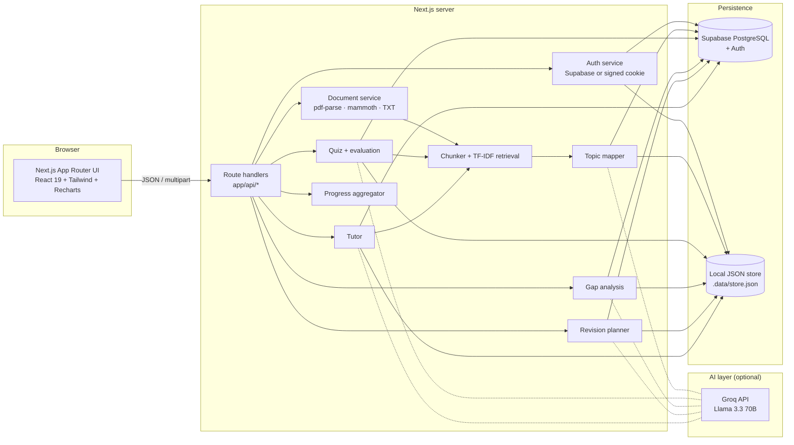

# GapFinder AI

**Find what you don't know. Learn what matters.**

GapFinder AI is a full-stack learning-gap platform built for the **iGebra.ai AI Intern Hackathon 2026**. It reads your own syllabus, notes and past papers, maps the topics they contain, runs a source-grounded diagnostic quiz, diagnoses the topics you are actually weak in, and turns that diagnosis into a day-by-day revision plan.

The app is not a UI mockup. Every screen reads and writes real records: uploads are extracted and chunked, questions are generated from retrieved source text, answers are scored on the server, mastery is recomputed from stored attempts, and the tutor cites the exact material it used.

---

## Demo credentials

| | |
| --- | --- |
| **Email** | `demo@gapfinder.ai` |
| **Password** | `GapFinder2026!` |

Signing into the demo account automatically provisions an original Biology study pack through the real extraction → chunking → topic-mapping pipeline. The sample materials are flagged `isDemo: true` and labelled **Demo source** in the UI. No quiz attempts or scores are fabricated: the sample pack gives you *material*, and you earn your own performance data.

You can also create a normal account from `/login?mode=signup`.

---

## What it does

1. **Ingest** — upload PDF, DOCX or TXT files (max 10 MB each, up to 5 at once). Text is extracted, normalised, chunked with overlap, and indexed with a TF-IDF lexical retriever. PDF page numbers and section headings are preserved for citations.
2. **Map topics** — the syllabus outline, document headings and recurring key concepts become a topic map. Past-paper questions are matched to topics to estimate exam frequency. Topic IDs are deterministic UUIDs, so re-analysing material does not erase mastery history.
3. **Diagnose** — generate a quiz for one topic or a mixed diagnostic. With Groq configured, Llama writes questions that are verified against retrieved excerpts. Without Groq, a real extractive cloze generator builds questions from declarative source sentences — never from an answer key.
4. **Score honestly** — answers are evaluated on the server, stored against the attempt, and mastery is recomputed per topic as cumulative correctness (not a mock score).
5. **Find gaps** — weak, medium, strong and unassessed topics are separated; missed concepts, past-paper frequency and importance are combined into a priority diagnosis and a narrative (Groq or rule-based).
6. **Plan revision** — a schedule is generated from the gap analysis, weighted by mastery gap, topic importance and exam frequency. Completing a quiz regenerates the plan while preserving completed tasks.
7. **Ask the tutor** — answers are retrieved from your chunks only. Every response carries citations; if your material does not cover the question, the tutor says so instead of guessing.
8. **Track progress** — mastery trend, quiz history, daily activity, topic improvements and today's tasks are all persisted.

---

## Architecture



### Design principles

- **Server-authoritative scoring.** Correct answers never reach the browser before submission. `PublicQuestion` deliberately omits `correctOptionIndex`, `explanation` and citations from the generate-quiz response.
- **Grounded generation.** Every retrieved excerpt is labelled `[S1]`, `[S2]`, … and the model is instructed to cite labels and refuse to invent. AI output is validated against the retrieved source text before it is accepted.
- **Truthful fallbacks.** If Groq is not configured, the UI says so. If a model is unavailable, the service falls back to `llama-3.1-8b-instant`; if question generation fails, it uses the extractive generator and reports why.
- **Deterministic identity.** Subjects and topics use UUIDv5-style deterministic IDs derived from student + subject + topic names. Re-mapping material preserves mastery and quiz history.
- **Two persistence modes, one interface.** A `DataStore` contract is implemented by both a Supabase adapter and a file-backed local adapter. The active mode is shown in the sidebar.

---

## Tech stack

| Layer | Choice |
| --- | --- |
| Framework | Next.js 16.4 (App Router, Turbopack, Cache Components) |
| Language | TypeScript 5 (strict) |
| UI | React 19, Tailwind CSS 4, Lucide icons, Recharts |
| AI | Groq Chat Completions with `llama-3.3-70b-versatile` (fallback `llama-3.1-8b-instant`) |
| Database | Supabase PostgreSQL + Supabase Auth (cloud), or local JSON (evaluation) |
| Documents | `pdf-parse` (PDF, per-page text), `mammoth` (DOCX), UTF-8 TXT |
| Retrieval | TF-IDF cosine similarity over document chunks — no embeddings, no hidden vector service |
| Deployment | Vercel + Supabase |

---

## Getting started

### Prerequisites

- Node.js **20+** (Node 22 recommended)
- npm
- Optional: a [Groq API key](https://console.groq.com/keys)
- Optional: a Supabase project with `supabase/schema.sql` applied

### 1. Install

```bash
npm install
```

### 2. Configure (optional)

```bash
cp .env.local.example .env.local
```

The app runs without any environment variables in **local mode**, using a JSON store at `.data/store.json` and signed HttpOnly cookies. Add Groq/Supabase values to unlock the cloud paths.

### 3. Run

```bash
npm run dev
```

Open [http://localhost:3000](http://localhost:3000) and sign in with the demo credentials above.

### 4. Verify

```bash
npm run lint          # ESLint — zero errors/warnings
npx tsc --noEmit      # strict TypeScript
npm run build         # production build
npm start             # production server
```

---

## Environment variables

| Variable | Required | Purpose |
| --- | --- | --- |
| `GROQ_API_KEY` | No | Enables Llama-generated quiz questions, gap narratives, plan summaries and tutor answers. |
| `GROQ_MODEL` | No | Model override. Default `llama-3.3-70b-versatile`; unavailable models fall back to `llama-3.1-8b-instant`. |
| `NEXT_PUBLIC_SUPABASE_URL` | No | Supabase project URL. All three Supabase values are required to activate cloud mode. |
| `NEXT_PUBLIC_SUPABASE_ANON_KEY` | No | Supabase anon key (used by the SSR client). |
| `SUPABASE_SERVICE_ROLE_KEY` | No | Server-only key for the data adapter. Never expose it to the browser. |
| `AUTH_SECRET` | Production local mode | HMAC secret for signed session cookies. Required on Vercel when not using Supabase, because the filesystem is ephemeral. Generate with `openssl rand -hex 32`. |
| `GAPFINDER_DATA_FILE` | No | Override the local JSON path. Defaults to `.data/store.json`, or a temp directory on Vercel. |

Cloud mode activates only when **all three** Supabase variables are present. Otherwise the app stays in local mode and displays **Local storage** in the sidebar.

---

## Persistence

### Local mode (default)

- Data: `.data/store.json` (git-ignored), or `GAPFINDER_DATA_FILE`.
- Auth: scrypt password hashes + HMAC-signed HttpOnly session cookies.
- On Vercel, local mode is intended for short-lived demos only: the filesystem is ephemeral. Set `AUTH_SECRET`; data may reset between deployments or instances.

### Supabase mode

1. Create a Supabase project.
2. Open the SQL editor and run [`supabase/schema.sql`](supabase/schema.sql).
3. Set `NEXT_PUBLIC_SUPABASE_URL`, `NEXT_PUBLIC_SUPABASE_ANON_KEY` and `SUPABASE_SERVICE_ROLE_KEY`.
4. Restart the app. The sidebar switches to **Supabase**.

The schema creates 12 tables, updated-at triggers, uniqueness constraints (including `student_answers.question_id` and `(student_id, topic_id)` on mastery), indexes, and Row Level Security policies. The server uses the service-role client; RLS remains enabled for browser safety.

Tables: `students`, `materials`, `document_chunks`, `subjects`, `topics`, `questions`, `quiz_attempts`, `student_answers`, `topic_mastery`, `revision_plans`, `revision_tasks`, `chat_history`.

---

## How scoring and diagnosis work

- **Attempt score** = correct answers ÷ questions answered.
- **Topic mastery** = cumulative correct ÷ cumulative attempted for that topic; thresholds are weak `< 50%`, medium `50–74%`, strong `≥ 75%`. Unassessed topics are excluded from overall mastery.
- **Diagnosis priority** in the narrative sorts by `(100 − mastery) × 0.7 + importance × 5`, with weak high-stakes topics surfaced first.
- **Revision priority** uses `masteryGap × (0.7 + importance × 0.06) × statusMultiplier`, so weak and exam-frequent topics are front-loaded.
- **Exam frequency** = number of past-paper questions matched to a topic by token overlap.
- **Retrieval** = TF-IDF cosine similarity over chunks, with section headings and material names indexed alongside body text.

No score is stored unless a quiz was submitted. No question is generated unless retrievable source text supports it.

---

## Project structure

```
app/
  page.tsx                     Landing page
  login/page.tsx               Login / signup
  (app)/layout.tsx             Authenticated shell
  (app)/dashboard/page.tsx     Mastery overview + onboarding
  (app)/materials/page.tsx     Upload / analyse / preview / delete
  (app)/topics/page.tsx        Topic map with citations
  (app)/quiz/page.tsx          Diagnostic quiz + results
  (app)/gap-analysis/page.tsx  Topic diagnosis + AI/rule-based narrative
  (app)/revision-plan/page.tsx Schedule + task completion
  (app)/tutor/page.tsx         Cited tutor chat
  (app)/progress/page.tsx      Trends, history, activity
  api/                         Route handlers (see API reference)

backend/
  types/                       Shared domain types
  data/samplePack.ts           Original demo study pack
  database/                    DataStore contract, local + Supabase adapters
  services/                    Auth, documents, RAG, topics, quiz, evaluation,
                               gap analysis, revision, tutor, progress, seed
  utils/                       Chunking, text, retrieval, scoring, validation

components/
  layout/ providers/ ui/       Shell, auth/toast, primitives
  materials/ topics/ quiz/     Feature views
  gap/ revision/ tutor/ progress/
  charts/ shared/ auth/

lib/                           API client, auth helpers, constants, formatting
supabase/schema.sql            Full schema + RLS
```

---

## API reference

All authenticated endpoints require the session cookie. Errors use `{ success: false, error, code }`.

| Method | Endpoint | Description |
| --- | --- | --- |
| `GET` | `/api/status` | Storage/auth/AI mode, retrieval settings, demo credentials, warnings. |
| `POST` | `/api/auth/signup` | Create a local account (or Supabase user). |
| `POST` | `/api/auth/login` | Sign in with email/password. |
| `POST` | `/api/auth/logout` | Clear the session. |
| `GET` | `/api/auth/session` | Current session + environment flags. |
| `GET` | `/api/materials` | List materials and chunk count. |
| `POST` | `/api/upload` | Multipart upload; extracts, chunks and indexes a document. |
| `GET` | `/api/materials/[id]` | Extracted-text preview and chunk stats. |
| `DELETE` | `/api/materials/[id]` | Delete a material and prune its citations. |
| `GET` | `/api/topics` | Topic map with mastery and citations. |
| `POST` | `/api/topics` | Rebuild the topic map (`{ applyAI?: boolean }`). |
| `POST` | `/api/generate-quiz` | Generate a quiz (`topicId?`, `subjectId?`, `difficulty`, `count`). |
| `POST` | `/api/evaluate` | Score an attempt (`attemptId`, `answers`, `durationSeconds?`). |
| `GET` | `/api/gap-analysis?ai=1` | Topic-level diagnosis; `ai=1` requests a Groq narrative. |
| `GET` | `/api/revision-plan` | Current plan (or `null`). |
| `POST` | `/api/revision-plan` | Create/regenerate a plan (`daysAvailable`, `hoursPerDay`, `examDate?`). |
| `PATCH` | `/api/revision-plan/tasks/[id]` | Mark a task complete/reopened (`{ completed: boolean }`). |
| `GET` | `/api/tutor?topicId=…` | Chat history and suggested prompts. |
| `POST` | `/api/tutor` | Ask a grounded question (`{ topicId, message }`). |
| `DELETE` | `/api/tutor?topicId=…` | Clear chat history for a topic. |
| `GET` | `/api/progress` | Stats, attempts, mastery trend, activity, plan, gaps. |
| `POST` | `/api/demo-seed` | Load/repair the sample workspace. |

---

## Demo walkthrough

1. Sign in with the demo account. The sample Biology pack is seeded automatically (or use **Load sample pack** on Materials).
2. Open **Materials** to inspect extracted text. Every sample file is marked **Demo source**.
3. Open **Topics** and inspect a topic's citations — they point to real chunks in the extracted documents.
4. Open **Quiz**, choose a topic (or a mixed diagnostic), answer, and submit.
5. Open **Gap Analysis** to see mastery, weak topics and missed concepts. Without Groq, the narrative is clearly labelled **Rule-based**.
6. Open **Revision Plan** and generate a 7-day plan; complete a task and confirm it stays completed.
7. Open **AI Tutor** and ask something covered by the material, then ask something unrelated. The first answer is cited; the second is refused because the material does not cover it.
8. Open **Progress** to see the attempt, mastery trend and activity.

---

## Honest limitations

- **Retrieval is lexical.** TF-IDF cosine similarity is transparent and dependency-free, but it does not understand synonyms the way embeddings do.
- **No OCR.** Scanned/image-only PDFs fail with a clear message; upload a text-based version.
- **AI is optional.** Without `GROQ_API_KEY`, quiz questions are extractive cloze questions and tutor answers are retrieved excerpts. Both are real, but they are not generative explanations. The UI labels the active mode.
- **Topic extraction is heuristic.** It works best with a syllabus that has numbered units and documents with clear headings. It filters document titles, exam section headings and question prompts, but unusual layouts may need manual re-analysis.
- **Mastery is cumulative.** Re-taking a quiz adds evidence rather than replacing old answers, which is deliberate but means early mistakes stay in the denominator.
- **Local mode is not durable on Vercel.** Use Supabase for production persistence.
- **No background jobs.** Uploads are processed synchronously inside the request; very large documents may hit serverless time limits.

---

## Deployment

### Vercel + Supabase (recommended)

1. Push this repository to GitHub.
2. Create a Supabase project and run `supabase/schema.sql`.
3. Import the repo into Vercel.
4. Add the environment variables:
   - `GROQ_API_KEY`
   - `GROQ_MODEL` (optional)
   - `NEXT_PUBLIC_SUPABASE_URL`
   - `NEXT_PUBLIC_SUPABASE_ANON_KEY`
   - `SUPABASE_SERVICE_ROLE_KEY`
   - `AUTH_SECRET`
5. Deploy. Vercel runs `next build` automatically.
6. Visit the deployment, sign in with the demo account, and verify the sidebar shows **Supabase** and **Groq AI**.

### Vercel without Supabase

Local mode works for a demo, but storage is ephemeral. At minimum set `AUTH_SECRET`; expect data to reset across deployments/instances.

### Other platforms

Any Node 20+ host that supports Next.js can run `npm run build && npm start`. Provide a persistent filesystem for local mode or set the Supabase variables.

---

## Hackathon notes

- Demo content is original and explicitly labelled; it is processed by the same pipeline as real uploads.
- No AI response, score, citation or progress value is mocked. When a capability is unavailable, the UI says so.
- Built during the iGebra.ai AI Intern Hackathon 2026.

---

## License

This project was built for the iGebra.ai AI Intern Hackathon 2026. Add a license before redistributing it as a product.
